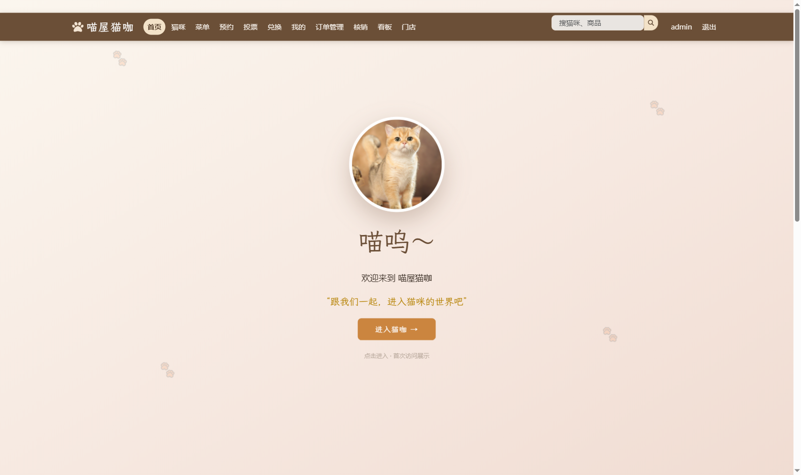
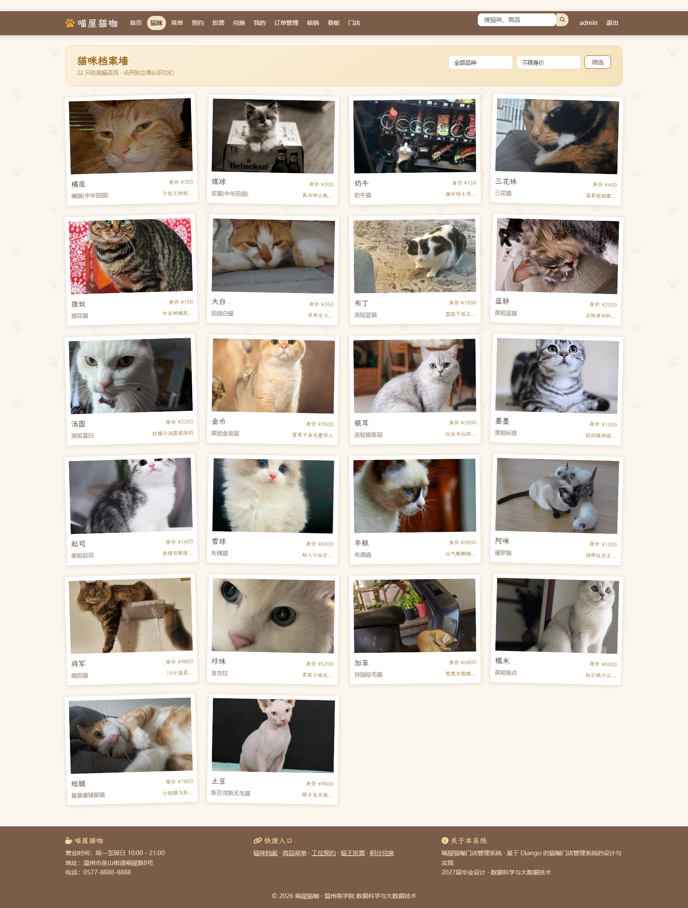
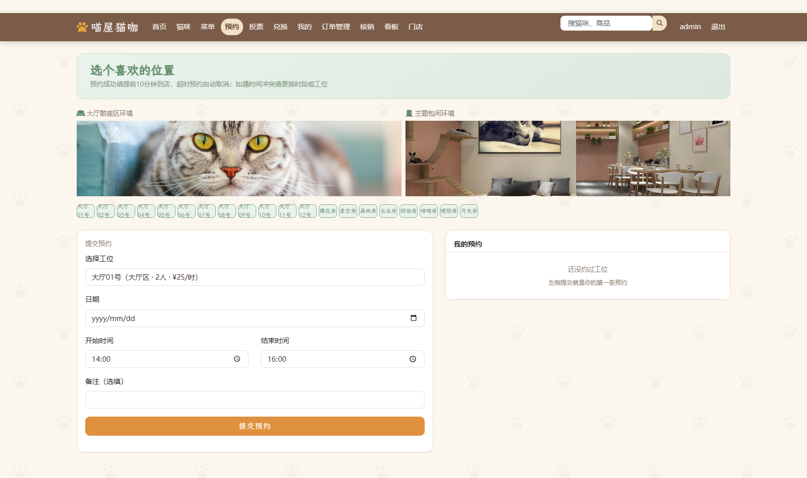
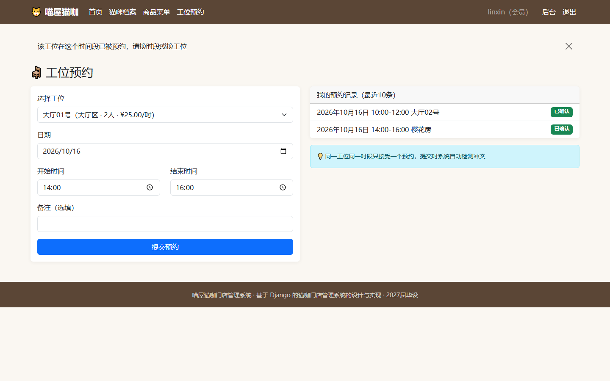
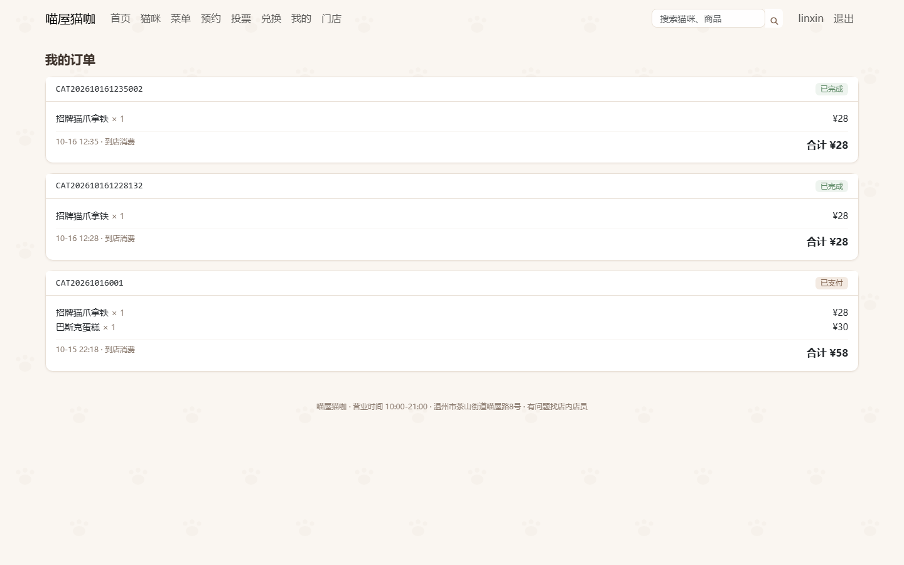

# 猫咖门店管理系统（毕业设计）

基于 Django 的猫咖门店全流程管理系统：从会员进店、点单消费到猫咪互动、经营分析的一站式解决方案。

## 功能总览（8 大模块 · 42 功能点）

- **会员管理**：登记、储值、积分自动累计
- **猫咪档案**：电子档案、健康/疫苗提醒
- **商品菜单**：饮品线上维护、库存管理
- **工位预约**：线上选时段、自动冲突检测
- **订单**：到店 + 预约双模式统一电子化
- **积分兑换**：消费-积分-兑换自动闭环
- **互动投票**：消费赠投票券选"猫王"
- **数据看板**：ECharts 营业额趋势、热销商品、猫咪人气

支持 **顾客 / 会员 / 店员 / 管理员** 四角色登录鉴权，按角色隔离数据。

## 截图

| 首页 | 猫咪档案 | 商品菜单 |
|---|---|---|
|  |  |  |

| 工位预约 | 预约冲突检测 | 我的订单 |
|---|---|---|
|  |  |  |

## 技术栈

Python 3.12 · Django 6 · SQLite · Bootstrap 5 · ECharts

## 安全设计

- 密码 PBKDF2 加盐哈希存储
- Django ORM 参数化查询防 SQL 注入
- CSRF 中间件 + XSS 转义
- 手机号中间四位脱敏显示

## 质量保障

22 项功能验收 + 7 项单元测试全部通过（v8 交付基线）。

## 快速开始

```bash
pip install -r requirements.txt
python manage.py migrate
python manage.py runserver
```
